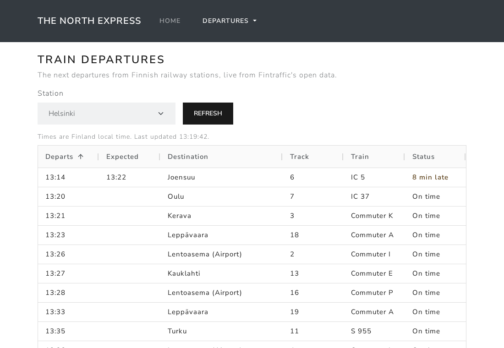

# The North Express

Live train departures for Finnish railway stations. Pick a station, get the next trains with their destination, track and status.

https://north-express.app.rgpl.xyz



Train data is from [Digitraffic](https://www.digitraffic.fi/en/) by Fintraffic, licensed [CC BY 4.0](https://creativecommons.org/licenses/by/4.0/). It needs no API key.

This started as an Angular 14 app on the Dutch NS API, which needs a subscription key. It has since been rebuilt on Angular 22 against Digitraffic so it runs on its own.

## Running it

Node 24, see `.nvmrc`.

```bash
npm ci
npm start    # http://localhost:4200
```

```bash
npx ng test --watch=false   # unit tests, Vitest
npm run e2e                 # Playwright; run `npx playwright install chromium` once first
npx ng lint
npx ng build                # dist/north-express/browser
```

The e2e tests answer Digitraffic from a fake that serves the responses saved in `src/testing/`, so they never hit the real API. They run against `ng serve`. Set `E2E_BASE_URL` to test a running build instead, which is what CI does with the production build behind the nginx config in `deploy/nginx/`.

## Departures

Digitraffic returns whole trains with their full timetables. For the chosen station the app uses the first stop where passengers can board and the train hasn't left yet. The P and I ring trains call at Pasila twice, so taking the first stop would show a departure that already happened. Cargo trains and shunting moves are left out.

Ring trains on their way to the airport show "Lentoasema (Airport)" rather than Helsinki, where they end.

To find a station, type part of its name (Ähtäri can be typed as "ahtari") or its code, such as TPE, and pick it from the list. "Airport" finds Lentoasema. The station picked goes into the address, as in `/departures/trains?station=TPE`, so a board can be bookmarked or shared.

Only stations with passenger traffic are listed, without the "asema" that Digitraffic puts at the end of many names.

A train running early counts as on time, and delays are the whole minutes Digitraffic reports. A departure is cancelled when the whole train is, or just its stop at that station.

If Digitraffic can't be reached, the page says so and offers Try again. When only a refresh fails, the departures already shown stay up with the time they are from.

Times are Finland time whatever the viewer's time zone.

## Stack

Angular 22 (standalone components, signals, zoneless), Bootstrap 5.3 with the app's own theme, ag-grid Community. Barlow and Barlow Condensed are self-hosted, so the only outside requests go to rata.digitraffic.fi.

## Deploying

Static build served by nginx on the rgpl VPS. CI runs the unit tests, the build and the e2e tests against that build on every push. Deploys are manual: [deploy/README.md](deploy/README.md).

## License

MIT, see [LICENSE](LICENSE).
